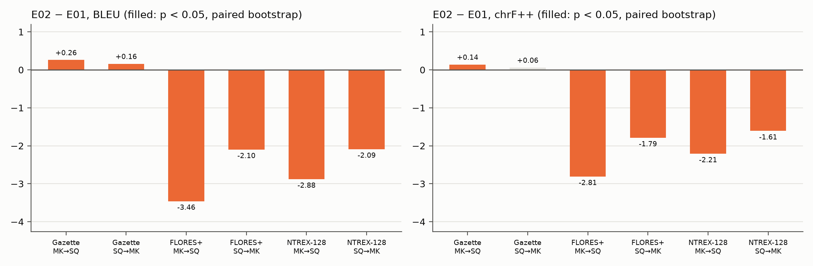
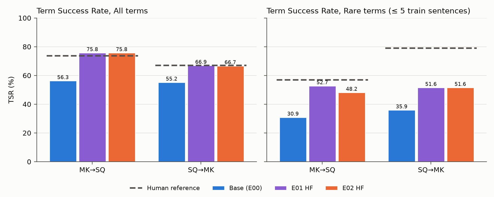
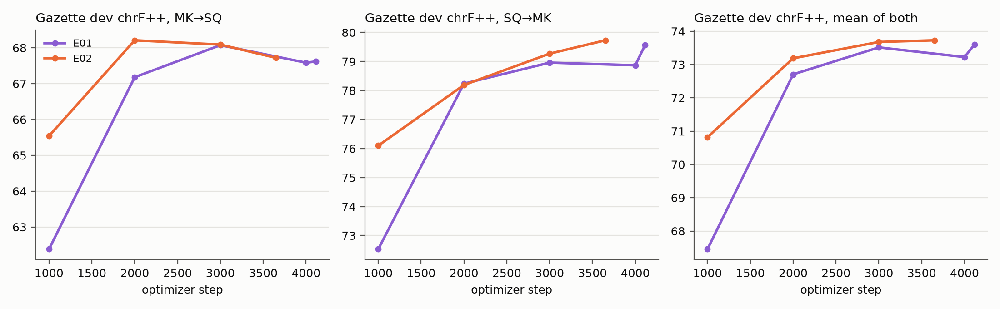
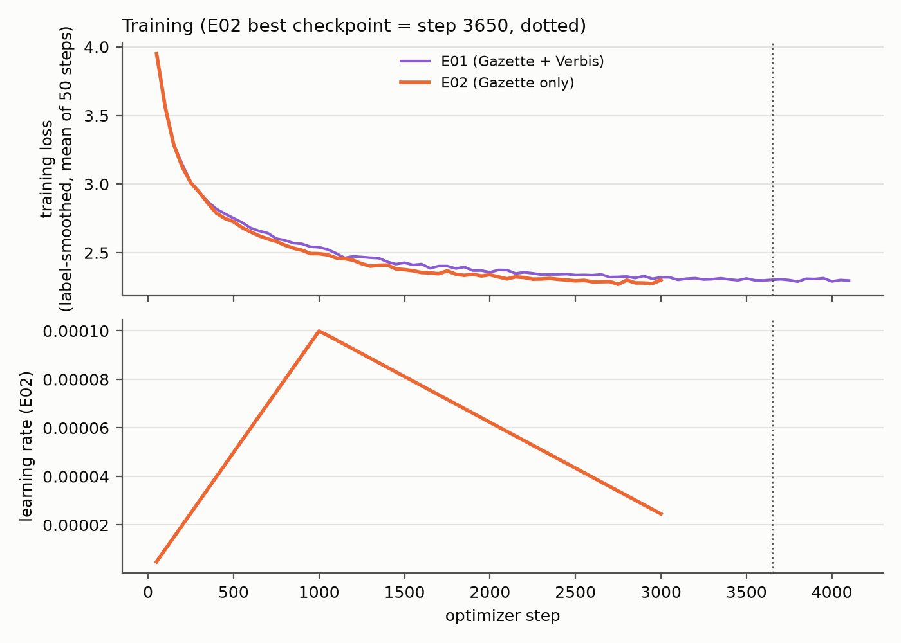

# Experiment report: E02_gazette_only

Gazette-only control (research-design arm M1), compared with E01_gazette_verbis_mix (arm M7-mix + D3) and the base model E00_base (arm M0). Generated 2026-10-07T09:15:35+00:00 by `experiments/E02_gazette_only/build_report.py` from results repo revision `a5d93046ed56f5442cb3b434f95d5f0f39774108` and git commit `fcb4355e2b41182a0322434568a3543a97360cf4`. Every number below is in `results.json`; every artifact is listed with its sha256 in `MANIFEST.json`.

## 1. Summary

E02 repeats E01 exactly except that no Verbis data was used for training (the only experimental difference between the two configs: `data.verbis.use_for_training`). It was trained on the same 479,852 bidirectional Gazette examples that formed the Gazette part of E01's mixture, for 3,650 optimizer steps (1.2148 h).
On the Gazette test set E02 was marginally better than E01: E02 − E01 = +0.16 to +0.26 BLEU and +0.06 to +0.14 chrF++ (3 of 4 differences significant at p < 0.05). Verbis training brought no in-domain benefit; the differences are a fraction of a point against a fine-tuning gain of more than 20 BLEU.
On the general-domain sets FLORES+ and NTREX-128, E02 scored below E01 in every comparison: -3.46 to -2.09 BLEU and -2.81 to -1.61 chrF++, 8 of 8 significant. Relative to the base model, E02 lost 4.6 to 7.89 BLEU on these sets (E01: 2.5 to 5.0). Adding Verbis data thus reduced, but did not prevent, the loss of general-domain quality.
Term Success Rate on the Gazette test was 75.75% (MK→SQ) and 66.7% (SQ→MK) for E02 against 75.76% and 66.94% for E01: Verbis training changed overall terminology use by less than a point. The only visible difference is on rare MK→SQ terms, where E01 was ahead by 4.55 points (116 vs 106 of 220 occurrences); on rare SQ→MK terms the two were equal (66 of 128).

## 2. What E02 isolates

`configs/E02_gazette_only.yaml` and `configs/E01_gazette_verbis_mix.yaml` were compared key by key. The only experimental difference is `data.verbis.use_for_training` (E01: True, E02: False); the other differing keys are bookkeeping (`code.git_commit`, `code.script`, `comparison.against`, `comparison.bookkeeping_differences`, `comparison.experimental_differences`, `data.flores_plus.revision`, `data.gazette.revision`, `data.ntrex.commit`, `description`, `exp_id`, `outputs.hf_results_repo`, `outputs.legacy_repo_name`, `outputs.work_dir`, `paper_arm`, `parent_exp`, `status`), all declared in the `comparison` block. The run also confirmed at start that the Gazette, FLORES+ and NTREX row counts and the Gazette-test and dev-subset content fingerprints equal E01's (`data.expected`), and E01 and E02 produced identical base-model translations on all three test sets (asserted by this script). Verbis was still loaded, for the terminology metric only (15,093 term pairs).

This isolates the effect of the Verbis data together with the change it implies in training length: E02 had 467,094 training examples (88.7% of E01's 526,704), so one epoch was 3,650 instead of 4,115 optimizer steps, and the linear learning-rate schedule decayed correspondingly sooner. The experiment cannot separate the content of the Verbis examples from the extra training steps they caused.

## 3. Data

| Quantity | Value |
|---|---|
| Gazette train / dev / test (pairs) | 270,083 / 13,355 / 10,174 |
| Gazette pairs removed as leakage | 30,157 |
| Clean training pairs | 239,926 |
| Bidirectional examples | 479,852 |
| Dropped by length filter (> 192 tokens) | 12,758 (2.66%) |
| Tokenised training examples (E01) | 467,094 (526,704) |
| Gazette examples, E02 = E01 | True |

Source: eval/run_info.json (dataset_sizes) of both experiments

## 4. Training and run history

Training used the hyperparameters below, identical to E01. The final invocation started at commit `ccd58f998fc91bd5a9e93d152ea10723b6009e0d` with a clean working tree. The run took 4 full invocations (plus 2 quick preflights) because of three failures unrelated to the model: a data check comparing a fingerprint to a row count (fixed in `bd3c440`), a crash appending to `dev_curve.csv` after the step-2000 dev evaluation (fixed in `ccd58f9`) and a rejected (invalid) Hugging Face token. The crash happened before checkpoint 2000 was saved, so the final invocation resumed from checkpoint 1000; steps 1–1000 were trained at `bd3c440`, steps 1001–3650 at `ccd58f9`. Between these commits only the dev-curve writer changed (`scripts/train/train_nllb_gazette_verbis_ct2.py | 6 ++++--`). Data preparation (steps 2–7) ran at `bd3c440` and was loaded from disk afterwards.

| Started | Kind | Commit | Outcome | Notes |
|---|---|---|---|---|
| 2026-10-01 08:57:00 | smoke test (--quick) | 8a2978e | completed |  |
| 2026-10-01 09:01:07 | smoke test (--quick) | a912aa1 | completed |  |
| 2026-10-01 09:53:05 | full run | 5673db1 | failed | Fatal: data check failed: gazette_test = <sha256>, config data.expected says 10174 |
| 2026-10-01 09:55:36 | full run | bd3c440 | failed | trained to step 2000; ComputeError: schema lengths differ |
| 2026-10-01 14:51:21 | full run | ccd58f9 | failed | Fatal: the Hugging Face token (from cached login) was rejected: Invalid user token |
| 2026-10-01 14:54:18 | full run | ccd58f9 | failed | resumed at step 1000; trained to step 3650; TypeError: 'pyarrow.lib.Table' object is not callable |

Source: progress.log

The analysis step (overlap, terminology, numbers) failed in the final invocation on a variable-shadowing bug and was re-run alone at commit `fcb4355e2b41182a0322434568a3543a97360cf4` (the training commit plus that fix) on the GPU machine's cached translations and processed data. The step that writes `DONE` and copies artifacts into `experiments/` never ran; the artifacts were imported by `scripts/registry/import_hf_artifacts.py` (see `SOURCES.json`).

| Setting | Value |
|---|---|
| Base model | facebook/nllb-200-distilled-600M@f8d333a |
| Optimizer | adafactor |
| Learning rate | 0.0001 |
| Schedule | linear, warmup 1000 steps |
| Epochs | 1 |
| Label smoothing | 0.1 |
| Weight decay | 0.01 |
| Max grad norm | 1.0 |
| Precision | bf16 mixed precision, TF32 matmul |
| Batch (per device × accumulation) | 8 × 16 = 128 |
| Gradient checkpointing | False |
| Seed / data seed | 42 / 42 |
| Total optimizer steps (E01) | 3,650 (4,115) |
| Checkpoint selection | eval_chrf every 1000 steps and at the end |
| Best step / dev chrF++ mean (E01) | 3650 / 73.73 (4115 / 73.6) |
| Training time, h (E01) | 1.2148 (1.361) |

Source: eval/run_info.json, checkpoints/checkpoint-3650/trainer_state.json

Hardware: NVIDIA GeForce RTX 5080 (16.61 GB). Software: Python 3.12.3, torch 2.14.0+cu130, transformers 5.17.0, ctranslate2 4.8.2, sacrebleu 2.6.0. Training ran at a median 108.5 samples/s with a peak of 12.64 GB GPU memory; the mean training loss fell from 3.94856 to 2.30213.

## 5. Results

Beam 4 on all test sets. BLEU signature `nrefs:1|case:mixed|eff:no|tok:13a|smooth:exp|version:2.6.0`; chrF++ signature `nrefs:1|case:mixed|eff:yes|nc:6|nw:2|space:no|version:2.6.0`. Paired bootstrap with 1,000 resamples (seed 42); 0.001 is the smallest p-value this can produce.

### 5.1 Main results: E00, E01, E02

| Test set | Dir. | BLEU E00 | BLEU E01 | BLEU E02 | p vs E00 | ΔBLEU vs E01 | p vs E01 | chrF++ E00 | chrF++ E01 | chrF++ E02 | p vs E00 | ΔchrF++ vs E01 | p vs E01 |
|---|---|---|---|---|---|---|---|---|---|---|---|---|---|
| Gazette test | MK→SQ | 27.74 | 54.02 | 54.28 | 0.001 | 0.26 | 0.001 | 50.30 | 72.28 | 72.42 | 0.001 | 0.14 | 0.006 |
| Gazette test | SQ→MK | 29.63 | 63.64 | 63.80 | 0.001 | 0.16 | 0.010 | 52.46 | 78.55 | 78.60 | 0.001 | 0.06 | 0.158 |
| FLORES+ devtest | MK→SQ | 22.08 | 19.45 | 15.99 | 0.001 | -3.46 | 0.001 | 48.58 | 46.61 | 43.80 | 0.001 | -2.81 | 0.001 |
| FLORES+ devtest | SQ→MK | 21.39 | 18.89 | 16.79 | 0.001 | -2.10 | 0.001 | 49.50 | 49.07 | 47.28 | 0.001 | -1.79 | 0.001 |
| NTREX-128 | MK→SQ | 23.14 | 18.13 | 15.25 | 0.001 | -2.88 | 0.001 | 48.91 | 44.49 | 42.29 | 0.001 | -2.21 | 0.001 |
| NTREX-128 | SQ→MK | 21.25 | 17.98 | 15.89 | 0.001 | -2.09 | 0.001 | 49.54 | 47.05 | 45.44 | 0.001 | -1.61 | 0.001 |

Source: eval/*_results.csv (E02), experiments/E01_gazette_verbis_mix/results/*.csv; significance: results.json



| Test set | Dir. | Metric | E01 | E01 95% CI | E02 | E02 95% CI | Δ (E02 − E01) | p |
|---|---|---|---|---|---|---|---|---|
| Gazette test | MK→SQ | BLEU | 54.02 | [53.36, 54.69] | 54.28 | [53.62, 54.94] | 0.26 | 0.001 |
| Gazette test | MK→SQ | chrF++ | 72.28 | [71.78, 72.80] | 72.42 | [71.93, 72.93] | 0.14 | 0.006 |
| Gazette test | SQ→MK | BLEU | 63.64 | [62.90, 64.37] | 63.80 | [63.05, 64.54] | 0.16 | 0.010 |
| Gazette test | SQ→MK | chrF++ | 78.55 | [77.96, 79.13] | 78.60 | [78.03, 79.18] | 0.06 | 0.158 |
| FLORES+ devtest | MK→SQ | BLEU | 19.45 | [18.64, 20.24] | 15.99 | [14.94, 17.08] | -3.46 | 0.001 |
| FLORES+ devtest | MK→SQ | chrF++ | 46.61 | [45.94, 47.25] | 43.80 | [42.96, 44.66] | -2.81 | 0.001 |
| FLORES+ devtest | SQ→MK | BLEU | 18.89 | [17.88, 19.89] | 16.79 | [15.77, 17.81] | -2.10 | 0.001 |
| FLORES+ devtest | SQ→MK | chrF++ | 49.07 | [48.28, 49.84] | 47.28 | [46.49, 48.07] | -1.79 | 0.001 |
| NTREX-128 | MK→SQ | BLEU | 18.13 | [17.48, 18.71] | 15.25 | [14.51, 16.01] | -2.88 | 0.001 |
| NTREX-128 | MK→SQ | chrF++ | 44.49 | [44.01, 45.00] | 42.29 | [41.73, 42.87] | -2.21 | 0.001 |
| NTREX-128 | SQ→MK | BLEU | 17.98 | [17.28, 18.67] | 15.89 | [15.02, 16.74] | -2.09 | 0.001 |
| NTREX-128 | SQ→MK | chrF++ | 47.05 | [46.49, 47.61] | 45.44 | [44.81, 46.07] | -1.61 | 0.001 |

Source: eval/translations_*.parquet of both experiments (recomputed); results.json#significance

### 5.2 Overlap-controlled results (Gazette test)

The overlap classes are computed against each model's own Gazette training sentences, which are the same in E01 and E02: 18.24% exact templates, 30.34% near duplicates and 51.42% novel pairs (E01: 18.24%, 30.34%, 51.42%).

| Class | Dir. | Pairs | % pairs | BLEU E00 | BLEU E01 | BLEU E02 | ΔBLEU | chrF++ E00 | chrF++ E01 | chrF++ E02 | ΔchrF++ |
|---|---|---|---|---|---|---|---|---|---|---|---|
| exact template | MK→SQ | 1856 | 18.24 | 32.67 | 71.03 | 71.72 | 0.69 | 51.88 | 81.65 | 82.03 | 0.38 |
| exact template | SQ→MK | 1856 | 18.24 | 21.17 | 78.11 | 78.50 | 0.39 | 50.45 | 86.66 | 86.91 | 0.25 |
| near duplicate | MK→SQ | 3087 | 30.34 | 28.50 | 57.90 | 58.12 | 0.22 | 50.59 | 75.25 | 75.36 | 0.11 |
| near duplicate | SQ→MK | 3087 | 30.34 | 31.25 | 68.06 | 68.39 | 0.33 | 53.09 | 81.78 | 81.89 | 0.11 |
| novel | MK→SQ | 5231 | 51.42 | 26.46 | 48.83 | 49.04 | 0.21 | 49.88 | 69.07 | 69.19 | 0.12 |
| novel | SQ→MK | 5231 | 51.42 | 29.93 | 58.59 | 58.61 | 0.02 | 52.45 | 75.38 | 75.37 | -0.01 |
| all | MK→SQ | 10174 | 100.00 | 27.74 | 54.02 | 54.28 | 0.26 | 50.30 | 72.28 | 72.42 | 0.14 |
| all | SQ→MK | 10174 | 100.00 | 29.63 | 63.64 | 63.80 | 0.16 | 52.46 | 78.55 | 78.60 | 0.05 |

Source: eval/gazette_test_overlap_results.csv (E02), experiments/E01_gazette_verbis_mix/analysis/

### 5.3 Terminology (Term Success Rate)

Same Verbis term list and matching rule as E01; the human-reference row is identical in both experiments (True). TSR differences between E01 and E02 were not significance-tested.

| System | Dir. | Term occurrences | Successes | TSR | Rare occurrences | Rare successes | Rare TSR |
|---|---|---|---|---|---|---|---|
| Human reference | MK→SQ | 20049 | 14758 | 73.61 | 220 | 125 | 56.82 |
| Base (E00) | MK→SQ | 20049 | 11284 | 56.28 | 220 | 68 | 30.91 |
| E01 HF | MK→SQ | 20049 | 15190 | 75.76 | 220 | 116 | 52.73 |
| E02 HF | MK→SQ | 20049 | 15188 | 75.75 | 220 | 106 | 48.18 |
| E02 CT2 int8 | MK→SQ | 20049 | 15190 | 75.76 | 220 | 107 | 48.64 |
| Human reference | SQ→MK | 9863 | 6613 | 67.05 | 128 | 101 | 78.91 |
| Base (E00) | SQ→MK | 9863 | 5448 | 55.24 | 128 | 46 | 35.94 |
| E01 HF | SQ→MK | 9863 | 6602 | 66.94 | 128 | 66 | 51.56 |
| E02 HF | SQ→MK | 9863 | 6579 | 66.70 | 128 | 66 | 51.56 |
| E02 CT2 int8 | SQ→MK | 9863 | 6596 | 66.88 | 128 | 66 | 51.56 |

Source: eval/terminology_results.csv (E02), experiments/E01_gazette_verbis_mix/analysis/terminology_results.csv



### 5.4 Number fidelity

| System | Dir. | Match (all) | Sentences with numbers | Match (with numbers) |
|---|---|---|---|---|
| Human reference | MK→SQ | 70.33 | 8130 | 66.51 |
| Base (E00) | MK→SQ | 78.16 | 8130 | 72.74 |
| E01 HF | MK→SQ | 83.87 | 8130 | 79.91 |
| E02 HF | MK→SQ | 84.65 | 8130 | 80.92 |
| E02 CT2 int8 | MK→SQ | 84.24 | 8130 | 80.46 |
| Human reference | SQ→MK | 70.33 | 8320 | 64.99 |
| Base (E00) | SQ→MK | 71.21 | 8320 | 64.89 |
| E01 HF | SQ→MK | 83.70 | 8320 | 80.41 |
| E02 HF | SQ→MK | 83.27 | 8320 | 79.93 |
| E02 CT2 int8 | SQ→MK | 82.77 | 8320 | 79.24 |

Source: eval/number_fidelity_results.csv (E02), experiments/E01_gazette_verbis_mix/analysis/

### 5.5 Quantisation (HF bf16 vs CTranslate2 int8)

As in E01, CTranslate2 could not use the GPU and ran on CPU (int8). Across the 12 paired comparisons the largest absolute difference was 0.44 BLEU and 0.25 chrF++; 4 reached p < 0.05.

| Test set | Dir. | BLEU HF | BLEU CT2 | ΔBLEU | p | chrF++ HF | chrF++ CT2 | ΔchrF++ | p |
|---|---|---|---|---|---|---|---|---|---|
| Gazette test | MK→SQ | 54.28 | 54.19 | -0.09 | 0.059 | 72.42 | 72.37 | -0.05 | 0.077 |
| Gazette test | SQ→MK | 63.80 | 63.68 | -0.12 | 0.007 | 78.60 | 78.62 | 0.01 | 0.309 |
| FLORES+ devtest | MK→SQ | 15.99 | 16.22 | 0.23 | 0.150 | 43.80 | 43.59 | -0.21 | 0.131 |
| FLORES+ devtest | SQ→MK | 16.79 | 16.72 | -0.07 | 0.295 | 47.28 | 47.19 | -0.09 | 0.208 |
| NTREX-128 | MK→SQ | 15.25 | 15.64 | 0.39 | 0.014 | 42.29 | 42.18 | -0.11 | 0.113 |
| NTREX-128 | SQ→MK | 15.89 | 16.33 | 0.44 | 0.007 | 45.44 | 45.69 | 0.25 | 0.017 |

Source: eval/*_results.csv, eval/translations_*.parquet; results.json#significance

### 5.6 Training dynamics

| Step | BLEU MK→SQ | chrF++ MK→SQ | BLEU SQ→MK | chrF++ SQ→MK | chrF++ mean | E01 chrF++ mean |
|---|---|---|---|---|---|---|
| 1000 | 45.91 | 65.54 | 60.89 | 76.10 | 70.82 | 67.46 |
| 2000 | 49.20 | 68.21 | 64.43 | 78.19 | 73.19 | 72.71 |
| 3000 | 49.88 | 68.09 | 65.19 | 79.27 | 73.68 | 73.52 |
| 3650 | 46.07 | 67.72 | 65.14 | 79.73 | 73.73 | – |

Source: progress.log (dev @ step lines); E01: experiments/E01_gazette_verbis_mix/results.json

`eval/dev_curve.csv` holds steps 1000, 2000, 3000 only; the dev evaluation at step 3650 (the selected checkpoint) is recorded in `progress.log` and `trainer_state.json`, and the table and figure use the log.





## 6. Interpretation

- **In-domain: no benefit from Verbis.** On the Gazette test E02 is at most 0.26 BLEU ahead of E01, and close to E01 on the novel subset too (E02 − E01: +0.21 and +0.02 BLEU). The in-domain gain reported for E01 comes from the Gazette data.
- **General domain: Verbis limits forgetting.** Both fine-tuned systems fall below the base model on FLORES+ and NTREX-128, but E02 falls further (-7.89 to -4.6 BLEU vs E00, against -5.0 to -2.5 for E01). The Verbis term and definition pairs are general vocabulary and short, non-gazette sentences, which plausibly keep the model closer to general-domain usage. The shorter E02 schedule is the other difference; fewer optimizer steps would not by themselves be expected to cause more forgetting, but this was not tested.
- **Terminology.** Training on the dictionary did not raise the overall TSR (E02 − E01: -0.01 MK→SQ, -0.24 SQ→MK): Gazette fine-tuning alone already brings the model to about the reference rate (E02 − reference: +2.14 and -0.35). Rare MK→SQ terms are the only place a lexicon effect shows (116 vs 106 successes), on too few occurrences to rely on.
- **Numbers and quantisation** behave as in E01 (number match with numbers: E02 − E01 = +1.01 and -0.48 points; int8 within 0.44 BLEU).

## 7. Limitations

- One seed per system (42); the E01–E02 differences on FLORES+/NTREX-128 are significant under the paired bootstrap, which accounts for test-set sampling but not for training variance.
- E01 vs E02 changes both the data and the number of optimizer steps (§2).
- E02 was trained across two invocations at two commits (resumed from checkpoint 1000); the code difference concerns only dev-curve logging, and the resume restored optimizer, scheduler and RNG state from the checkpoint.
- TSR on rare terms rests on few occurrences and was not significance-tested; TSR is a matching heuristic, not a correctness measure.
- 48.58% of Gazette test pairs are templates or near duplicates of training sentences.

## 8. Reproducibility

- Results repo (private): `EdonFetaji/mk-sq-nllb600m-e02-gazette-only` at `a5d93046ed56f5442cb3b434f95d5f0f39774108`; E01 translations from `EdonFetaji/mk-sq-nllb600m-gazette-verbis` at `3fad45be925bbdc88e6b07672628ba8e1b180178`.
- Training: commit `ccd58f998fc91bd5a9e93d152ea10723b6009e0d` (steps 1–1000 at `bd3c440`); analysis: `fcb4355e2b41182a0322434568a3543a97360cf4`; report: `fcb4355e2b41182a0322434568a3543a97360cf4`.

```bash
# GPU machine
python3 scripts/train/smoke_test_nllb_run.py E02_gazette_only --quick
python3 scripts/train/train_nllb_gazette_verbis_ct2.py E02_gazette_only
# local, after the run
uv run python scripts/registry/import_hf_artifacts.py E02_gazette_only
uv run python experiments/E02_gazette_only/build_report.py
```

